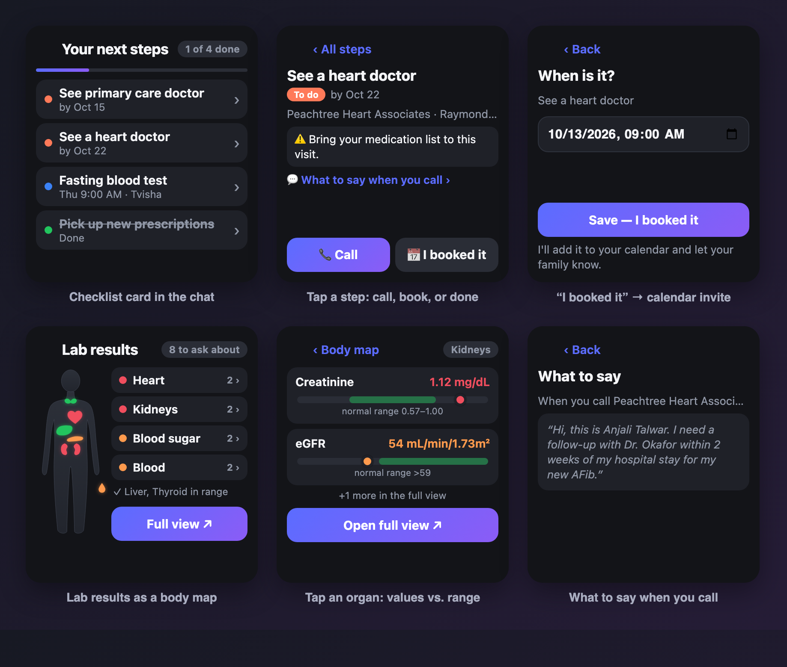
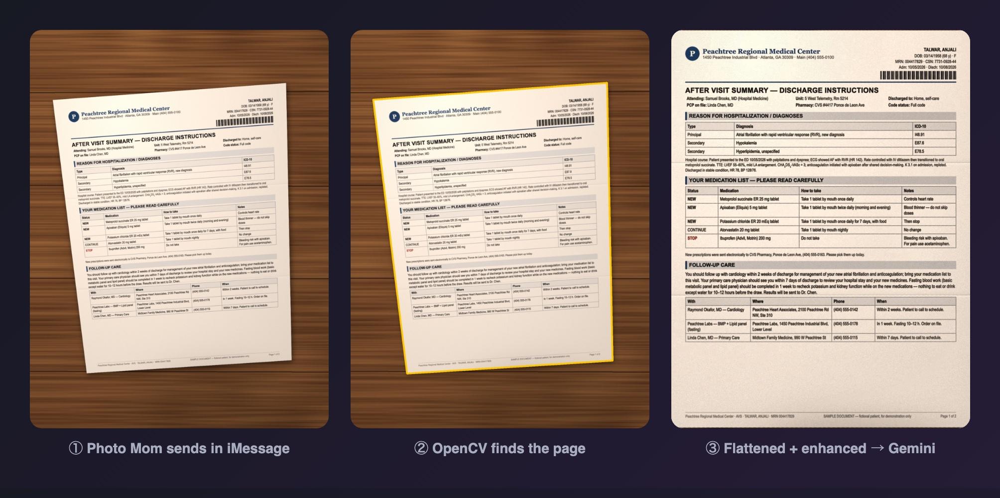
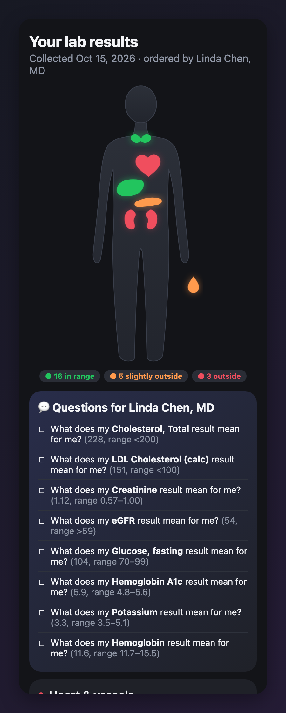
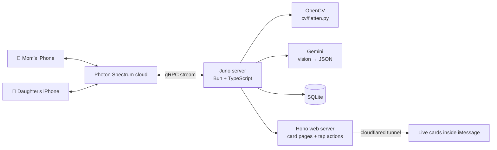

<h1 align="center">Juno</h1>

<p align="center"><b>Hospital paperwork → a clear plan → follow-ups that actually happen.<br/>All inside iMessage.</b></p>

<p align="center">
  Built at <b>Hacklanta 2026</b> · Photon Spectrum (iMessage) · Gemini · OpenCV · Bun + TypeScript
</p>

<p align="center"></p>

## The problem

When an older parent leaves the hospital, they go home with a dense stack of discharge papers: new medicines, warning signs, and three or four follow-ups that each need a phone call "within 7 days" or "within 2 weeks". The follow-ups are buried in prose and small tables, and they're exactly the part that slips. Their kids want to help, but they live in another city and only hear about it later.

## What Juno does

Mom texts Juno a photo of her paperwork. That's the whole interface: no app to install, no account, just the Messages app she already uses.

1. **Reads it.** OpenCV finds the page in the photo and flattens it; Gemini extracts diagnoses, medicines, warning signs, and every follow-up with its phone number and deadline.
2. **Explains it.** Warning signs come first ("Call 911 if…"), then a plain-English summary and the medicine changes, including what to *stop* taking.
3. **Turns it into a checklist.** An interactive card right in the chat. Tap a step to call the clinic, read a two-line script of what to say, or mark it booked with a date picker.
4. **Tracks it.** "booked heart doctor Tue 2pm", or a photo of the appointment reminder, updates the card in place and sends a calendar invite with prep notes.
5. **Nudges, gently.** At most two reminders per step, each with the number and the script.
6. **Loops in family.** Mom adds her daughter and picks what she can see with a native iMessage poll. If Mom has *read* both reminders and still hasn't booked, Juno quietly asks her daughter to help. When the daughter texts "booked it Thu 9am", Mom's card updates to **Booked · with Tvisha**, and Mom gets the calendar invite.
7. **Makes lab results readable.** An interactive body map: tap an organ to see each value on a bar against the range printed on the report, plus a list of questions to bring to the doctor.

**Juno never books appointments and never gives medical advice.** It explains what the paper says, makes the next steps easy, and makes sure they happen.

## From photo to plan

<p align="center"></p>

The photo is cleaned up before any AI sees it. [`cv/flatten.py`](cv/flatten.py) finds the page (Canny edges → contours → largest quadrilateral), warps it flat to US Letter proportions, and boosts contrast (CLAHE + sharpening). If no page edge is found, it falls back to the original photo, so the flow never blocks on computer vision. Every document has a `/debug/:docId` page showing each step side by side.

Then Gemini reads all the pages of a burst in one call and returns strict JSON, validated with zod. The prompts follow three rules: extract only what's on the page, never invent a phone number or date, and use plain language.

<table>
<tr>
<td width="46%"></td>
<td>

### Lab results, made legible

- Each test is mapped to an organ by a **fixed table in code** (kidneys, liver, heart & vessels, thyroid, blood sugar, blood & general), never by the model.
- Colors are **computed from the reference range printed on the report**: in range, slightly outside (≤10% past the edge), or outside. The model never decides what's "good" or "bad".
- Every test gets a one-line, neutral description of *what it measures*, with no interpretation.
- Results outside the range become **questions for the doctor**, and they're added as notes on the upcoming primary-care visit.

</td>
</tr>
</table>

## Built for iMessage with Photon Spectrum

Juno runs on [Photon's Spectrum SDK](https://github.com/photon-hq/spectrum-ts) and uses most of what iMessage can do:

| Feature | How Juno uses it |
|---|---|
| **Live app cards** (`app(url, { live: true })`) | The checklist and body map are small web apps running *inside* the message bubble. Taps work, so you can call, book, and mark steps done without leaving the chat. |
| **Edit in place** (`edit()`) | Cards update themselves when something changes. The card's `miniAppCardSession` is stored in SQLite, so edits keep working after a server restart. |
| **Native polls** | "What should Tvisha see?" and "Which one did you book?" |
| **Read receipts** | Juno only asks family to help after Mom has actually *seen* both reminders. |
| **Tapbacks** | ❤️ on a reminder → "Did you book it? What day and time?"; ❓ → the number and script again. |
| **Typing, mark-as-read, 👀, effects** | Feels like texting a person; confetti when the whole list is done. |
| **Attachments** | Calendar invites (`.ics`) for every booked visit, with a reminder the day before. |
| **Separate 1:1 chats** | The caregiver gets their own conversation with Juno, with updates and the ability to book for Mom. |

## Safety by design

- **Warning signs always come first** in a discharge explanation.
- **No diagnoses, no treatment advice.** Every explanation points back to the doctor or pharmacist.
- **Code decides the important things:** lab colors, organ mapping, reminder timing, and escalation are deterministic code, not model output.
- **Fictional data only.** Every document, name, and number in this repo is made up (555-01xx phone numbers, "SAMPLE DOCUMENT" on every page).
- **Secrets stay local** in `.env` (gitignored).

## Architecture



```
src/
  index.ts          boot: web server, Spectrum, 10s scheduler
  router.ts         inbound messages: albums, debounce, roles, onboarding, polls, receipts, tapbacks
  intent.ts         understand a text: local patterns first, Gemini only when needed
  gemini.ts         schemas + prompts; model fallback; photo-result cache
  vision.ts         runs cv/flatten.py (HEIC → JPEG via sips)
  flows/            documents · status (booked/done) · caregiver · nudges · admin
  web/              tracker card · lab body map · theme · routes + card actions
  cards.ts          send or edit a live card (persisted sessions)
  labs.ts           bands + organ mapping (code, not LLM)
  db.ts, clock.ts   SQLite + virtual clock for demos
cv/flatten.py       page detection + perspective correction + enhancement
docs/               fictional documents (HTML/PDF/PNG), demo photos, screenshots
```

## Run it yourself

**You need:** [Bun](https://bun.sh), Python 3, [`cloudflared`](https://developers.cloudflare.com/cloudflare-one/connections/connect-networks/downloads/), a [Photon](https://app.photon.codes) project (the Free plan works), a [Gemini API key](https://aistudio.google.com/apikey), and iPhones with the **Spectrum** iMessage app installed (for live cards).

```bash
bun install
python3 -m venv .venv && .venv/bin/pip install opencv-python-headless numpy
cp .env.example .env    # add SPECTRUM_PROJECT_ID/SECRET, GEMINI_API_KEY, phone numbers

# The Photon Free plan only messages registered numbers:
bunx photon login
bunx photon spectrum users add -p <project-id> --phone +1XXXXXXXXXX \
  --first-name Anjali --last-name Talwar --email you@example.com --invite

bun run doctor          # checks credentials, Gemini, and the tunnel
bun run tunnel          # terminal 1: public URL for the card pages
bun run start           # terminal 2: Juno
```

Then text Juno from a registered iPhone.

### Demo script

1. **Mom** sends [`1-discharge-page1.jpg`](docs/photos/1-discharge-page1.jpg) and [`2-discharge-page2.jpg`](docs/photos/2-discharge-page2.jpg) together → warning signs, summary, medicines, checklist card.
2. **Mom:** "add my daughter Tvisha *(her number)*" → she votes in the poll → Tvisha's phone gets an intro and the list.
3. `bun run admin skip 2d` → first reminder (open Mom's chat) · `bun run admin skip 1d` → second reminder (open it) → **Tvisha gets a heads-up**.
4. **Tvisha:** "booked it Thu 9am" → Mom's card shows **Booked · with Tvisha**, plus a calendar invite.
5. **Mom** sends [`3-appointment-card.jpg`](docs/photos/3-appointment-card.jpg) → the heart doctor visit is booked.
6. **Mom** sends [`4-lab-results.jpg`](docs/photos/4-lab-results.jpg) → the body map.

`bun run admin reset` starts over. From an admin phone, `/help` lists the chat commands (`/skip`, `/reset`, `/status`, `/card`, `/labs`).

## What we learned

- **Live Spectrum cards are web views inside the bubble** (about 271×300 pt, no scrolling). Taps and in-bubble navigation work, but `window.open` doesn't, so "Full view" falls back to Juno texting the link.
- **Card images must be JPEG**: PNGs are rejected upstream.
- **Several photos sent together arrive as one album message**, so photos are registered on arrival and downloaded in the background to keep multi-page documents in one turn.
- **iMessage read receipts mark the whole chat read**, so a receipt counts as "read up to here".
- **Free-tier Gemini allows 20 requests per model per day**, so photo results are cached, common replies ("booked it Thu 9am") are parsed locally first, and quick jobs run on Flash-Lite. A full demo run costs zero AI calls on a rehearsal.
- We patched one Spectrum SDK edge case: polls echoed back with an empty title dropped votes ([`patches/`](patches)).

## Limitations

- Juno doesn't book appointments: hospital scheduling systems aren't open to patient-facing apps, so it guides and tracks instead.
- On Photon's Free plan Juno can only text registered numbers and can't create group chats, so the caregiver gets a separate 1:1 conversation.
- The demo uses a virtual clock (`admin skip`) to show multi-day reminders in a few minutes.

## Disclosure

Built during Hacklanta 2026. Uses the open-source [spectrum-ts](https://github.com/photon-hq/spectrum-ts) SDK, the Gemini API, OpenCV, Hono, and resvg. All documents, people, and medical data in this repository are fictional and for demonstration only.

## Team

- **Nikhilesh Thiru** · [@NikhileshThiru](https://github.com/NikhileshThiru)
- **Tvisha Talwar** · [@tvisha-t](https://github.com/tvisha-t)
